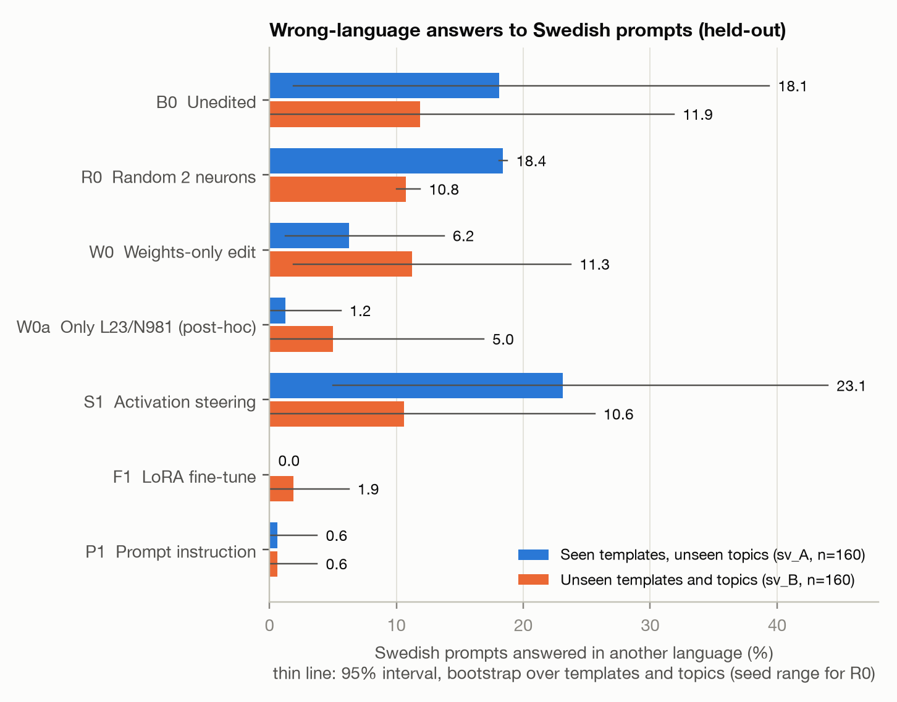

# Reading the weights finds the neurons behind Swedish→Danish drift. It does not tell you which one to delete.

*Jafar Banar · 18 November 2026 · research note for SE.LLMA · longer version with all details: [report/report.pdf](report/report.pdf)*

**Summary.** `Qwen2.5-1.5B-Instruct` answers 15% of plain Swedish prompts in Danish, Norwegian or German. Reading its weights without running it singles out 2 of 250,880 MLP neurons, and both do control Swedish-versus-Danish output. But the edit proposed from the weights alone (delete both) only cut wrong-language answers from 15.0% to 8.8%, because the two neurons do opposite jobs and the weights do not show that. One batch of forward passes does. No edit improved Swedish competence, and the edits that worked did so by removing the model's Danish. A one-line prompt instruction or an 80-example LoRA fixes the failure better. I recommend SE.LLMA use weight reading as a diagnostic, not as a way to improve Swedish.

## 1. What the article shows, and what it does not

*Strongest evidence:* Experiments 4 and 5 (weights written in one shot for small control networks, no tools, no feedback, effects far too large to be noise) and Experiment 3 (copying heads read from middle-layer weights and checked head by head against measurements the LLM never saw). The authors also publish failures and full logs.

*Main limitations:* the headline result (Qwen3.5-0.8B, MATH-500 from 7.9% to 48.1%) repairs a decoding pathology in which 93% of baseline answers hit the token limit. It came from feedback, not from reading: the authors' logs show 50 forward-pass batches with activations, 158 turns and 80 Python runs, while the 10- and 25-pass runs produced different edits that barely worked. There is one run per budget and no control anywhere: no random edit, no inference-setting baseline, no steering or fine-tuning on the same budget. The pure weight-reading results use tiny networks and three or four cases.

*Justified:* a frontier LLM can compile known algorithms into small networks and, with feedback, remove an obstacle that hides an existing ability. *Not justified:* that this adds capabilities (their own Gemma result says no), that reasoning about weights did the work at language-model scale, or that small edits are safe edits.

## 2. Hypothesis

**Question.** When a model answers a Swedish prompt in Danish, is that an obstacle a tiny weight edit can remove, and can the edit be found by reading the weights alone?

**Why it matters.** Drifting into a neighbouring language is the kind of linguistic imprecision a Swedish model must not have, and it is the article's best case: the model *can* answer in Swedish when told to, so the ability exists and is only hidden.

**Supports:** a weights-only edit at least halves held-out drift, beats random edits, and leaves English, perplexity and Swedish grammar intact. **Challenges:** it performs like a random edit; it needs feedback; it works by destroying Danish; or Swedish grammar improves, which would be a new capability. These criteria were committed in [PREREGISTRATION.md](PREREGISTRATION.md) before any edit was run, with my prior for the weights-only edit at 30%.

## 3. Experiment

**Weight reading, zero forward passes.** A Swedish-minus-Danish/Norwegian direction from 17 function-word pairs (*och/og*, *inte/ikke*, …) in the embedding matrix; every MLP neuron scored by how strongly it writes along it. The scores look like noise except for two outliers: layer 23 neuron 981 (z = −9.2) and layer 22 neuron 1821 (z = −7.9). Both write towards Danish tokens ("ø", " kvinder", ".dk") and away from Swedish ones ("Ö", " och", " ett").

**Edit W0, fixed in advance:** set both neurons' output weights to zero (3,072 of 1.54 billion weights).

**Comparisons:** unedited model (B0); two random neurons in the same layers, 5 seeds (R0); the same edit family tuned on 2,040 dev generations (W1); a prompt instruction, "Svara alltid på svenska." (P1); activation steering (S1); LoRA on 80 dev prompts with the model's own Swedish answers as targets (F1).

**Data:** 160 dev prompts; 320 held-out prompts on unseen topics, half from unseen templates. Regression checks: English and Danish prompts, perplexity on natural text in four languages, 237 Swedish grammatical minimal pairs, 40 factual notice questions. Greedy decoding, seed 0, pinned model revision.

## 4. Results (held-out)

| Condition | Swedish answers (n = 320) | Δ vs B0 [95% CI] | Fixed / broken | English → English | Danish → Danish | Swedish PPL | Grammar pairs |
|---|---|---|---|---|---|---|---|
| B0 Unedited | 85.0% | – | – | 100% | 82.5% | 52.5 | 73.0% |
| R0 Random 2 neurons | 85.4% | +0.4 | – | – | – | 52.5 | – |
| **W0 Weights-only, pre-registered** | **91.2%** | +6.2 [−4.7, +18.8] | 35 / 15 | 100% | 13.1% | 56.8 | 72.6% |
| W0a Delete only L23/N981 *(post-hoc)* | 96.9% | +11.9 [+2.8, +23.4] | 38 / 0 | 100% | 10.0% | 51.7 | 73.4% |
| W0b Delete only L22/N1821 *(post-hoc)* | 20.0% | −65.0 [−77.8, −50.0] | 3 / 211 | 100% | 80.0% | 77.2 | 68.8% |
| S1 Activation steering | 83.1% | −1.9 [−7.5, +3.8] | 11 / 17 | 100% | 77.5% | 55.4 | 70.0% |
| F1 LoRA, 80 examples | 99.1% | +14.1 [+2.8, +28.1] | 47 / 2 | 100% | 78.8% | 63.2 | 73.0% |
| P1 Prompt instruction | 99.4% | +14.4 [+3.4, +28.4] | 47 / 1 | 74.4% | 3.8% | 52.5 | 73.0% |

Intervals resample templates and topics jointly. W1 is absent because feedback tuning selected exactly W0.

1. **The reading was right.** Both neurons are causal and random neurons do nothing. Deleting N981 alone removes all 25 Danish answers and breaks nothing. Deleting N1821 alone flips 211 of 320 Swedish answers to Danish or Norwegian, by changing 0.0001% of the weights.
2. **The edit built from the reading was wrong.** Both neurons' output weights say "Danish, not Swedish", so I deleted both. But N1821 fires *negatively* while the model writes Swedish (mean −19.0), so it supports Swedish; N981 fires only on drift (+35.5). Weights show what a neuron writes, not when or with which sign. The pre-registered edit missed its target: a 42% cut where 50% was required, an interval that includes zero, and Swedish perplexity up 8%.
3. **Feedback on a narrow dev set misled.** W0 scored 100% on dev prompts, 91.2% held out, and gained nothing on unseen templates (88.1% → 88.8%).
4. **Capability removal, not a selection fix.** Under W0a only 10% of Danish prompts still get Danish answers (from 82.5%) and Danish perplexity rises 72%. Drift into German and the English-source failure on notice questions (18% correct Swedish answers) are untouched. LoRA fixes drift and keeps Danish.
5. **No new capability.** Grammar-pair accuracy stays at 73% (article gender at chance) and Swedish perplexity never improves by more than 1.5%.

*Example.* "Skriv tre meningar om vindkraft." B0: "Vindkraft **er et** energiprodukt, **der er tilgængelig**…" (Danish). W0: "Vindkraft **är en** energi som kan bräcka på många olika **måter**…" (Swedish with a Norwegian word: the language changed, the quality did not).

## 5. Recommendation

**Do not pursue weight-space programming as a way to make Swedish models better.** In the article's own best case it matched neither one line of prompt nor 80 examples of fine-tuning, added no Swedish competence, and its one clean success cost the model its Danish.

**Keep two things.** The drift metric: a 15% wrong-language rate is invisible to perplexity and grammar tests and takes minutes to measure. And weight reading as a diagnostic: it located two causally decisive neurons in seconds on a CPU.

**Most informative next experiment.** Run the reading and the drift test on base models and their SE.LLMA Swedish fine-tunes, across three or four model families. Does Swedish fine-tuning remove drift, and does the weight change concentrate on the neurons the reading flags? If the reading predicts drift across checkpoints, it becomes an audit that needs no inference, which is the article's most valuable unproven claim. In parallel, pre-register the sign-aware edit (W0a) on new, human-written prompts.

**Limitations.** One model, one prompt seed, greedy 48-token answers. Prompts, minimal pairs and Danish translations were written by an AI agent, not a native speaker. Drift concentrates in a few templates, so intervals are wide. W0a and W0b were not pre-registered. The language detector mislabels some mixed answers, though a detector-free function-word metric gives the same ranking. Steering was tuned on a 9-point grid and may be undersold. LoRA trained on the model's own Swedish, which probably explains its perplexity cost.
