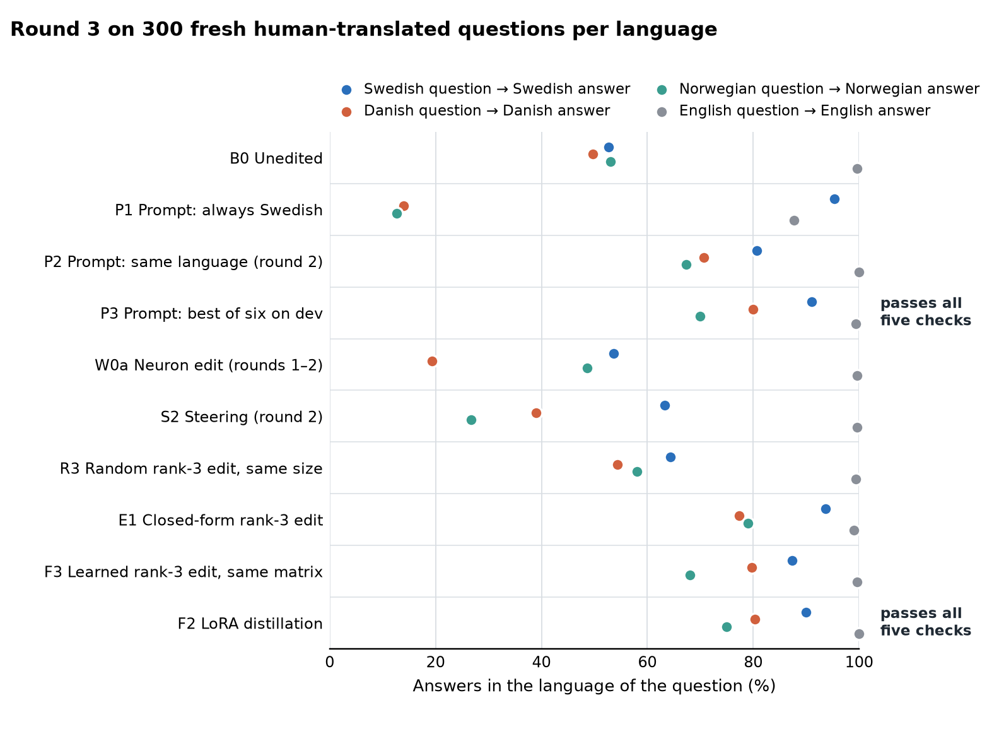

# Weight-only screening finds neurons that control Danish output. Deleting them does not make a model answer in Swedish.

*Jafar Banar · 19 November 2026 · research note for SE.LLMA · full details and references: [report/report.pdf](report/report.pdf)*

**Summary.** I tested whether reading a model's weights, without running it, can find and remove the cause of a Swedish-language failure. On `Qwen2.5-1.5B-Instruct` the screen found two neurons that do affect answer language, but the pre-registered edit (delete both) missed its criteria. A one-neuron edit found afterwards looked strong; on fresh data it did not change how often the model answers in Swedish, and it damaged Danish output in all four models tested. A third round asked whether any fix works: a tuned request-aware prompt and a small LoRA passed five pre-set checks. I recommend that SE.LLMA not deploy the neuron ablation and that it measure correct answers in the requested language.

## 1. What the article shows, and what it does not

*Strongest evidence:* Experiments 4 and 5 (weights written in one shot for small control networks, with no tools or feedback) and Experiment 3 (copying heads read from weights and checked against measurements the LLM never saw).

*Main limitations:* the headline result (Qwen3.5-0.8B, MATH-500 from 7.9% to 48.1%) repairs a looping failure in which 93% of baseline answers hit the token limit. The authors' logs show substantial model feedback: 50 forward-pass batches, 158 turns, 80 Python runs. Each feedback budget produced a different edit, with one run per budget, so the design cannot separate reasoning about weights from feedback. There is no baseline given the same budget and no random edit.

*Justified:* a frontier LLM can compile known algorithms into small networks and, with feedback, remove an obstacle hiding an existing ability. *Not justified:* that such edits add capabilities, or that small edits are safe.

## 2. Hypothesis

**Question.** When a model answers a Swedish prompt in Danish, can a tiny weight edit found by reading the weights alone remove that, without other damage? This is a direct failure of linguistic precision and the article's best case: the model can answer in Swedish when told to.

**Supports:** the edit at least halves wrong-language answers on held-out prompts, beats random edits, and leaves English, perplexity and grammar intact. **Challenges:** it performs like a random edit, needs feedback, or works by damaging Danish. Each round's criteria were committed before its test data was run ([round 1](PREREGISTRATION.md), [2](PREREGISTRATION_ROUND2.md), [3](PREREGISTRATION_ROUND3.md)).

## 3. Experiment

**Screen, zero forward passes.** A Swedish-minus-Danish/Norwegian direction from 17 function-word pairs in the embedding matrix; each of 250,880 MLP neurons scored by how strongly its output weights point along it. Two stood out: layer 23 neuron 981 and layer 22 neuron 1821.

**Edits and controls.** Pre-registered: zero both neurons' output weights (3,072 of 1.54 billion). Exploratory: neuron 981 only. Controls: random neurons, a prompt instruction, activation steering, LoRA.

**Data.** Round 1: 320 held-out synthetic prompts. Round 2: new templates, 300 human-translated questions (MKQA), native grammar pairs, three more models. Round 3: 700 further MKQA questions in Swedish, Danish, Norwegian and English (300 for the test).

## 4. Results

| Stage | What the result establishes |
|---|---|
| **Round 1, pre-registered** | Deleting both neurons: Swedish answers 85.0% → 91.2%, 95% interval of the gain [−4.7, +18.8]; Swedish perplexity +8%. Criteria missed. |
| **Round 1, exploratory** | Neuron 981 alone: 96.9%. Neuron 1821 alone: 20.0%. Discovery estimates only. |
| **Round 2, pre-registered** | Human-translated questions: 50.0% → 51.0% Swedish. Danish questions answered in Danish: 47.3% → 16.0%. On new templates the unedited model was wrong only 3.4% of the time, so repair could not be tested there. |
| **Round 3, pre-registered, a different question** | Any fix that works? LoRA distillation: Swedish 52.7% → 90.0%, Danish 49.7% → 80.3%, Norwegian 53.0% → 75.0%, English 100%, perplexity within 0.4%. A tuned prompt does as well. |

1. **The screen found consequential neurons, but not a fix.** Both neurons change answer language, in opposite directions; random neurons do nothing. Weights showed what a neuron writes, not when or with which sign it fires.
2. **The edit damages Danish output every time**: in all four models (47% → 16%, 51% → 41%, 82% → 35%, 81% → 21%) and again on round 3's fresh questions (50% → 19%).
3. **The neuron is not where the choice is made.** With the answer text held fixed, zeroing neuron 981 does nothing on Swedish prompts and shifts Danish prompts towards Swedish. It carries a "this conversation is Danish" signal computed earlier.
4. **The failure depends on the prompts.** On human-translated questions the unedited model answers in English 46% of the time and in Danish or Norwegian 3%.
5. **Two fixes pass a held-out test.** LoRA distillation of the instructed behaviour (1.1 million parameters, 15 minutes on a laptop) and the best of six request-aware prompts each reach 90% Swedish without costing Danish, Norwegian, English, perplexity, grammar or answer content. On Qwen2.5-0.5B, with no retuning, the LoRA passes again (Swedish 67% → 87%); the prompt does not transfer (Danish falls 6 points).
6. **A closed-form weight edit gets the language and loses content.** A rank-3 change to one matrix, computed from activation statistics without gradients, gives 93.7% Swedish, but answers containing the gold answer fall from 21 to 13 of 213. Four random edits of the same size moved Swedish answers by −8 to +12 points, so a single random control can mislead.
7. **No method improved Swedish competence.** Grammar-pair accuracy stayed within one point. The fixes change which language is chosen, not how good the Swedish is.

## 5. Recommendation

**On the available evidence, SE.LLMA should not deploy this neuron ablation.** Where it changed behaviour it did so by suppressing Danish, and on human-translated questions it did not change how often the model answers in Swedish.

**Do these instead.** Measure *correct answers in the requested language* on SE.LLMA's own checkpoints, with human-written prompts; wrong-language rates here ranged from 0.6% to 50% across models and prompt sets. Where the system prompt is under control, choose a request-aware instruction per model on development data (one of six plausible wordings lowered Swedish answers to 6%). Otherwise distil that behaviour with a small LoRA. Better Swedish itself still needs training on real Swedish text.

**Most informative next experiment.** Test weight screening as a diagnostic: screen base models and their Swedish fine-tunes before measuring them, and check whether the screen predicts which checkpoints drift. For any proposed edit, run several random edits of the same size and a content check beside it.

**Limitations.** Small models (0.5–1.7 billion parameters), mostly greedy 48-token answers. The baseline depends on the system prompt: under another English system prompt the unedited model already answers 81% of Swedish questions in Swedish. The AI-written synthetic prompts were reviewed by a second language model, not by a native speaker ([review](results/llm_language_review.md)); rounds 2 and 3 rest on human-translated questions. Language labels are automatic; a second identifier agrees on 92% of answers. The LoRA sits on the 90% line (89.7% under the second identifier) and inherits the model's weak Swedish. Round 1 and the main stages of round 2 were rerun and reproduced every answer; round 3 was not rerun.
