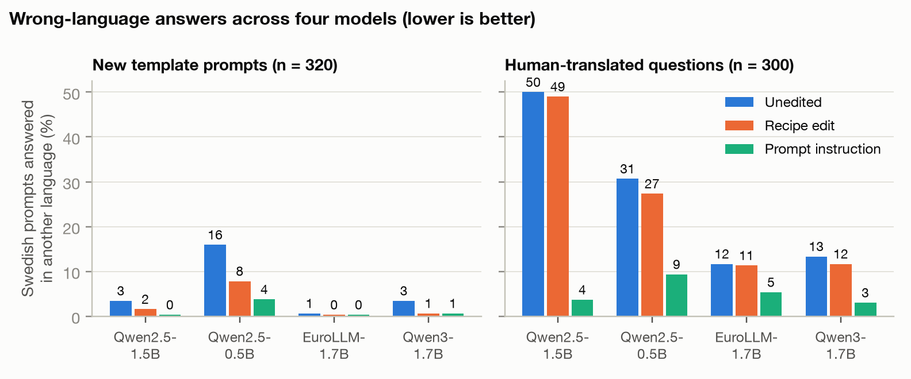

# Weight-only screening finds neurons that control Danish output. Deleting them does not make a model answer in Swedish.

*Jafar Banar · 19 November 2026 · research note for SE.LLMA · full details: [report/report.pdf](report/report.pdf)*

**Summary.** I tested whether reading a model's weights, without running it, can find and remove the cause of a Swedish-language failure. On `Qwen2.5-1.5B-Instruct` the screen nominated two neurons, and deleting either changes the language of the answers, in opposite directions. The pre-registered edit (delete both) missed its criteria. A one-neuron edit found afterwards looked strong, but in a second, pre-registered round on fresh data it barely changed how often the model answers in Swedish, and it damaged Danish output every time. The failure it targets also turned out to depend on my first prompt set: on human-translated questions the model answers in English, not Danish, half the time. A one-line prompt fixes most of that. I recommend that SE.LLMA not use weight edits to improve Swedish, and that it measure correct answers in the requested language.

## 1. What the article shows, and what it does not

*Strongest evidence:* Experiments 4 and 5 (weights written in one shot for small control networks, no tools, no feedback, very large effects) and Experiment 3 (copying heads read from middle-layer weights and checked head by head against measurements the LLM never saw).

*Main limitations:* the headline result (Qwen3.5-0.8B, MATH-500 from 7.9% to 48.1%) repairs a looping failure in which 93% of baseline answers hit the token limit. The authors' logs show weight analysis combined with substantial model feedback: 50 forward-pass batches with activations, 158 turns and 80 Python runs. The 10-, 25- and 50-pass runs each produced a different edit, with one run per budget, so the design cannot separate the contribution of reasoning about weights from that of feedback. The unedited model is the only control; there is no search or editing baseline given the same budget, and no random edit.

*Justified:* a frontier LLM can compile known algorithms into small networks and, with feedback, remove an obstacle that hides an existing ability. *Not justified:* that such edits add capabilities (their own Gemma result says no), or that small edits are safe edits.

## 2. Hypothesis

**Question.** When a model answers a Swedish prompt in Danish, can a tiny weight edit found by reading the weights alone remove that, without other damage?

**Why it matters.** Answering in a neighbouring language is a direct failure of linguistic precision, and it is the article's best case: the model can answer in Swedish when told to.

**Supports:** a weights-only edit at least halves wrong-language answers on held-out prompts, beats random edits, and leaves English, perplexity and grammar intact. **Challenges:** it performs like a random edit, needs feedback, works by damaging Danish, or changes Swedish grammar scores. Criteria were committed before any edit was run ([PREREGISTRATION.md](PREREGISTRATION.md)); round 2 was committed before its test data was run ([PREREGISTRATION_ROUND2.md](PREREGISTRATION_ROUND2.md)).

## 3. Experiment

**Screen, zero forward passes.** A Swedish-minus-Danish/Norwegian direction from 17 function-word pairs in the embedding matrix; each of 250,880 MLP neurons scored by how strongly its output weights point along it. Two neurons scored lowest: layer 23 neuron 981 (z = −9.2) and layer 22 neuron 1821 (z = −7.9). A score this extreme is not rare on its own: 11% of control directions built from the same words paired at random produce one. What supports the two neurons is the deletion test below.

**Edits.** Pre-registered W0: zero both neurons' output weights (3,072 of 1.54 billion). Exploratory W0a: neuron 981 only. Controls: random neurons in the same layers; a Swedish prompt instruction (P1); activation steering; LoRA on 80 examples.

**Data.** Round 1: 320 held-out synthetic prompts. Round 2: 320 prompts from 40 new templates, 300 human-translated Swedish questions (MKQA) with Danish and English versions, 200 grammar pairs from native treebank sentences, and three more models. Greedy decoding, pinned revisions.

## 4. Results

| Stage | What the result establishes |
|---|---|
| **Round 1, pre-registered** | Deleting both neurons: Swedish answers 85.0% → 91.2%, +6.2 points, 95% interval [−4.7, +18.8]; Swedish perplexity +8%. Criteria missed. The gain is 81.9% → 93.8% on templates seen in development and 88.1% → 88.8% on unseen ones. Three templates hold 39 of the 48 unedited failures. |
| **Round 1, exploratory** | Neuron 981 alone: 96.9%. Neuron 1821 alone: 20.0%. These are discovery estimates from data that had already been looked at. |
| **Round 2, pre-registered** | New templates: the unedited model is wrong only 3.4% of the time (11 of 320), below the 5% gate set in advance, so repair could not be tested there (96.6% → 98.4%). Human-translated questions: 50.0% → 51.0% Swedish, [−0.7, +2.7]. Danish questions answered in Danish: 47.3% → 16.0%. Grammar pairs unchanged (native 75.0% → 76.0%). |

1. **The screen nominated consequential neurons, in four models.** A frozen recipe (screen the weights, then use one batch of answers to see each neuron's sign) picked neuron 981 and kept 1821 on the original model. On Qwen2.5-0.5B it cut Danish/Norwegian answers from 36 to 12 of 320 (random neurons: no change). On Qwen3-1.7B and EuroLLM-1.7B, which barely drift, it left Swedish answers unchanged.
2. **The edit damages Danish output every time.** Danish answers to Danish questions fell in all four models (47% → 16%, 51% → 41%, 82% → 35%, 81% → 21%). Told explicitly to answer in Danish, the edited model manages 29%, against 83% unedited. Danish comprehension was not tested.
3. **The neuron is not where the wrong choice is made.** With the answer text held fixed, zeroing neuron 981 does nothing on Swedish prompts (+0.14 nats, [−0.10, +0.48]) and shifts Danish prompts 4.5 nats towards Swedish before the first answer word. It carries a "this conversation is Danish" signal computed earlier. Weights showed what it writes, not when or with which sign it fires.
4. **The failure depends on the prompts.** On human-translated questions the unedited model answers in English 46% of the time and in Danish or Norwegian 3%. "Svara alltid på svenska." gives 96% Swedish; "answer in the user's language" gives 79% and also raises Danish (47% → 67%) and keeps English (99%).
5. **No edit improved Swedish competence.** Grammar-pair accuracy stayed within one point for every edit that helped; the harmful one-neuron edit lowered it (73.0% → 68.8%).
6. **Round 1 undersold steering.** A 54-setting search (round 1 used 9) found a steering vector that cut wrong-language answers on new templates from 11 to 2 and raised Swedish answers on human-translated questions by 9.7 points [+6.0, +13.7], more than any neuron edit, with a smaller cost to Danish answers (47% → 39%).

## 5. Recommendation

**Do not deploy or pursue this kind of edit to improve Swedish.** Where it changed behaviour it did so by suppressing Danish, and on realistic questions it did not change how often the model answers in Swedish.

**Do these instead.** Measure *correct answers in the requested language* on SE.LLMA's own checkpoints, with human-written prompts; wrong-language rates here ranged from 0.6% to 50% across models and prompt sets. Try request-aware prompting first, and treat fine-tuning on real Swedish text as the fix (the small LoRA here removed drift while keeping most Danish answers, at a cost of 20–25% higher perplexity).

**Most informative next experiment.** A prospective test of weight screening as a diagnostic: screen base models and their Swedish fine-tunes before measuring them, and check whether the screen predicts which checkpoints drift and what fine-tuning changes.

**Limitations.** Four small models, greedy decoding, 48-token answers. Synthetic prompts were written by an AI agent; they pass checks against Swedish Wiktionary, native corpus counts and a spell-checker, and round 2 adds human-translated questions and native sentences, but no native speaker has reviewed them. The language detector over-counts mixed answers (90% agreement with a blinded re-labelling of 48 answers by the AI agent). MKQA answers were scored for language, with factual accuracy too low (9%) to analyse jointly. The LoRA baseline was not rerun in round 2.
